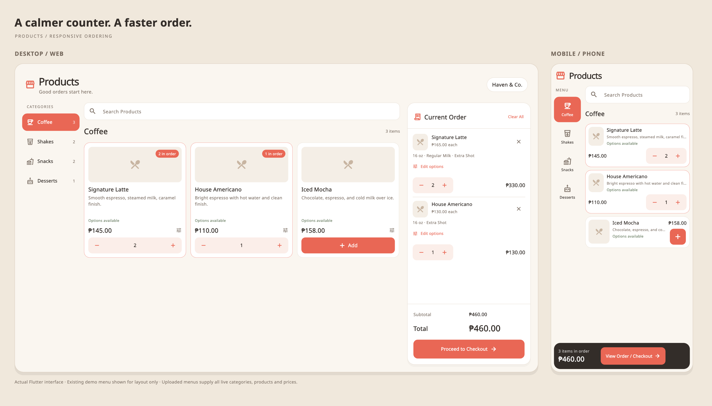

# Responsive Products page



This image renders the actual Flutter widgets side by side. It uses the repository's existing demo menu solely to demonstrate the layout; no preview products or categories are embedded in the ordering UI. Neutral image placeholders demonstrate products without photos.

## Menu upload

Open **Settings → Upload Menu** and choose an `.xlsx` workbook. The existing Admin **Import Excel** action uses the same importer. Review the product count and confirm replacement. Parsing and validation happen before any live catalog changes.

The **Products** worksheet supports these columns (header capitalization, spaces, underscores and hyphens are normalized):

| Column | Meaning |
| --- | --- |
| Name | Required product name |
| Price | Required finite, non-negative price |
| Product ID | Optional stable identifier; keep it unchanged when updating a menu |
| Category Name / Category | Displayed category name |
| Category ID | Optional stable category identifier |
| Category Icon | Optional existing supported category emoji |
| Description | Optional product description |
| Image URL / Image / Photo URL | Optional image URL; missing or failed images use a neutral placeholder |
| Available / Availability / Is Available | Yes/No, True/False, 1/0, Available/Unavailable, In stock/Out of stock, or Sold out; defaults to available |
| Modifier Group IDs | Optional comma-, semicolon-, or newline-separated group IDs |
| Badge | Optional existing product metadata |

Categories are derived from the workbook's rows. Rows without category information appear under Uncategorized. Uploaded products receive only their specified modifier groups; category names do not cause invented sizes or add-ons.

An optional **Modifiers** worksheet defines arbitrary choices:

| Column | Meaning |
| --- | --- |
| Group ID | Required reference used by Products |
| Option Name | Required choice label |
| Group Name | Optional displayed group label, defaults to its ID |
| Option ID | Optional stable choice identifier, defaults to its name |
| Price Delta / Additional Price | Additional price, defaults to zero |
| Min Selected / Minimum | Required choice count, defaults to zero |
| Max Selected / Maximum | Maximum choice count, defaults to one; zero means unlimited |
| Default / Is Default | Optional Yes/No initial selection |

Repeat a group's name and selection limits consistently on every option row. Existing configured groups can also be referenced by ID without a Modifiers sheet. Unknown group IDs and malformed values reject the import. Export Excel includes image/availability fields and the referenced modifier definitions for round trips.

After replacement, matching cart lines use updated product and option prices. Removed or unavailable products and lines that no longer satisfy required choices are removed. The selected category is preserved by ID when possible.

## Ordering behavior

- At 900px of available dashboard width, the order panel stays on the right while the catalog scrolls independently.
- At narrower widths, a fixed bottom bar opens the live order sheet; below 600px products use horizontal cards and a compact category rail.
- The desktop grid adapts between two, three and four columns.
- Search spans product names, descriptions and categories across the entire uploaded menu. Selecting a category clears the search.
- Products without options add immediately. Configurable products open the selection dialog. When multiple variants are in the cart, the product-card minus button lets the cashier choose which line to change.
- Checkout retains discounts, payment selection, cash/change validation and receipt printing.

## Recreate the preview

```sh
flutter test test/products_preview_test.dart --dart-define=RENDER_POS_PREVIEW=true
```

The renderer writes `docs/products-redesign/responsive-preview.png`. Normal test runs skip this artifact-generation test.
